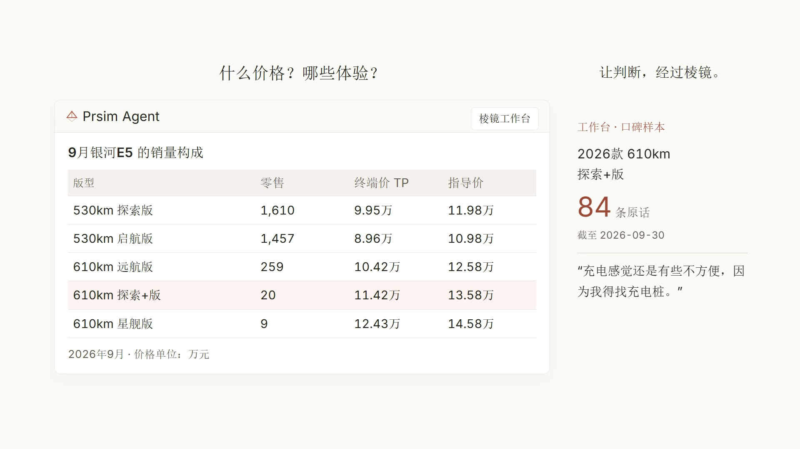

# Prism-Agent · 让汽车产品经理问到可信的数字

[](LICENSE)
[](eval/reports/index-eval-2026-11-01T09-30-39-689Z.md)
[](#测试)


> **English Overview** — Prism-Agent is a production-deployed LLM data agent for automotive product managers. It answers business questions across four dimensions (spec / owner reviews / sales / social sentiment) with one non-negotiable guarantee: **every number must be verifiable**. Instead of trusting the model's self-discipline, it enforces an *evidence gate* (`submit_conclusion` → CLAIM validation) and execution-layer guardrails (allowlists, fail-closed checks), and it is backed by a frozen 63-task golden eval set with adversarial trap questions (pass@1 = 95.2%, avg 4.78/5). Built on the [pi](https://github.com/badlogic/pi-mono) agent runtime: Python/FastAPI backends, React workbench, Langfuse observability, fully reproducible eval pipeline.

**产品演示（72s，点击播放）**

[](docs/media/demo.mp4)

<video src="docs/media/demo.mp4" controls muted preload="metadata" poster="docs/media/poster.jpg" width="720"></video>

---

## 一、为什么做这个

汽车产品经理每天都在问三类问题：*“银河 E5 上个月卖了多少？”*、*“用户对它的隔音到底满不满意？”*、*“它和铂智 3X 比配置差在哪、值不值差价？”*

通用 LLM 直接回答这些问题会**编数字**——而且编得理直气壮。直接接数据库又要求用户会写 SQL。Prism-Agent 的答案是：**Agent 查库、人问业务话，但每个数字必须可复算**。

## 二、棱镜四维度

| 维度 | 数据面 | 回答的问题 |
|---|---|---|
| **配置** | 车型/版型配置库 + 差价计价 | 产品力对比：差在哪、值多少 |
| **口碑** | owner_reviews + review_tags 聚合 | 需求验证：车主真实褒贬 |
| **销量** | sales_trim 月末零售 + 同版型环比 | 市场结果：卖了多少、此消彼长 |
| **舆情** | 社媒采集 + 极性/缺陷簇 | 外挂第四维：仅与销量双向交叉 |

分层规则内建于提示词与执行层：默认 **配置 → 口碑 → 销量** 顺序推进；口碑只下口碑内结论，**市场侧数据不归因产品力**（相关性不当因果）。

## 三、核心设计：让 Agent 的数字可信

LLM 的自律不可靠，所以防线全部放在**执行层**，提示词只负责“德治”：

1. **语义工具层，不写裸 SQL** — Agent 只能调用语义化工具（`search_cars` / `get_dimension_reviews` / `compare_configs_valued` 等 12 个库/看板工具 + TikHub 社媒工具 + web 搜索/技能/导出/人工确认），由 `prism-api` 的白名单路由表转发到各数据服务。工具参数与返回经过统一截断层，防上下文爆炸。
2. **出口闸（evidence gate）** — 基于库数据的数字结论，必须先调 `submit_conclusion` 提交 CLAIM（结论文本 + `supported_by` 行级引用 + `as_of` 口径 + 数值清单），由服务端独立验证通过后才能交付。派生数字须声明 `source=derived` 与上游。**回复正文只是展示层，不是验证对象。**
3. **护栏在执行层（hooks/tools）** — `.pi/extensions/prism-guardrails` 实现工具白名单、参数校验、名称真值核验（模型生成的车系名与库源名不一致即 fail-closed）、注入内容不执行等硬约束。
4. **fail-closed 纪律** — 名称/数值不一致、数据缺口、身份存疑时如实声明缺失，不静默放行。数据缺口场景输出“假设清单 + 证据强度 + 缺什么能坐实”，弱证据假设不进结论区。

提示词层（[`AGENTS.md`](AGENTS.md) / [`SYSTEM.md`](SYSTEM.md) / [`PRISM_ANALYSIS.md`](PRISM_ANALYSIS.md) / [`PRISM_GENERAL.md`](PRISM_GENERAL.md)）按角色/维度/纪律/受众分层注入，正文输出面向用户职业语言，内部字段名零泄漏。

## 四、架构

```
┌─────────────────────────────────────────────────────────────┐
│ prism-web   React 对话工作台 + 四大看板（配置/口碑/销量/舆情）      │
└──────────────┬──────────────────────────────────────────────┘
               │ SSE 流式 / 会话历史 / 溯源抽屉（过闸 CLAIM → 行级引用）
┌──────────────▼──────────────┐    ┌───────────────────────────┐
│ pi 网关 (9200)               │───▶│ pi Agent 运行时             │
│ 会话/中止/埋点/统一截断         │    │ · 分层提示词 · 护栏扩展       │
└──────────────┬──────────────┘    └─────────────┬─────────────┘
               │                                  │ 语义工具调用（白名单）
┌──────────────▼──────────────────────────────────▼─────────────┐
│ prism-api (8002)  FastAPI                                      │
│ · 工具路由表（12 库/看板工具 → dashboards/sentiment 后端）          │
│ · 出口闸 /verify/claim：CLAIM 结构化验证 + 名称真值核验            │
│ · 登录门禁 / 会话 / 导出 / xlsx 台账                               │
└───────┬───────────────┬─────────────────┬──────────────────────┘
        ▼               ▼                 ▼
 prism-dashboards   prism-sentiment    prism-ops
 (8010)             (8000)             (8020)
 销量/配置/口碑三库    舆情采集/极性/       北极星埋点看板
 +差价计价            缺陷簇
```

- **数据层**：SQLite（`sales_trim` 月末零售 / `owner_reviews`+`review_tags` / 配置快照 / 舆情帖）。评估用**只读快照 + 哈希指纹**，保证判分可复现。
- **观测层**：Langfuse 全轨迹（每次工具调用/判分理由挂 trace），prism-ops 独立端口承载北极星指标与 badcase 回放。
- **部署**：单机 ECS + Nginx，六个服务由 `prism.py` 一键拉起。

## 五、评估体系：不是 demo，是量产工程

这是本项目最重的投入，方法论对齐“预注册 + 冻结快照 + 显著性检验”：

- **63 题金标卷**（冻结快照 `snap-20261012`）：覆盖配置/口碑/销量/舆情/跨维度/多轮/社媒技能，含 **17 道陷阱题**（编数诱导、提示词泄漏、注入攻击、名称张冠李戴、越界归因…）
- **终版成绩**（[报告](eval/reports/eval-2026-11-01T09-30-39-689Z.rescored.json)）：**pass@1 = 95.2%（60/63），均分 4.78/5，陷阱拦截 17/17，真值锚点 26 题 0 失败**
- **判分器**：truth 锚点（数字必须命中金标行）+ rubric 要素 + trap 正则三类机器判分，判分器自身带 24 个单测防误判
- **预注册显著性实验**：假设/单元/判定规则先冻结再跑（McNemar 精确检验），见 [eval/reports/prereg-2026-11-02.md](eval/reports/prereg-2026-11-02.md)
- **取代性对照（B 系列）**：验证“通用 agent + 口径文字化”能否取代本系统，结论不成立——护栏与证据形态不可替代（`eval/reports/challenger-*.json`）
- **测试**：`python -m pytest` 各子服务共 **1173 个用例**（prism-api 28 / prism-dashboards 207 / prism-sentiment 938）

## 六、工程过程：openspec 十步流程

所有功能走统一 change 流程（探索 → 方案 → 十步施工 → 隔离子代理审查 → 真实对话 E2E → 门禁 → 归档），全过程文档在 [`openspec/changes/`](openspec/changes/)（30+ 个已归档 change）。审查采用**施工与审查分离**：审查子代理只拿代码不给设计结论，防确认偏误。

## 七、仓库结构

```
├─ prism-api/          FastAPI 主服务：工具路由 · 出口闸 · 会话 · 门禁 · pi 网关
├─ prism-web/          React + Vite 对话工作台与看板
├─ prism-dashboards/   配置/销量/口碑三看板 + 语义查询 + 差价计价引擎
├─ prism-sentiment/    舆情采集（GPL/公开源）· 极性引擎 · 缺陷簇 · 看板
├─ prism-ops/          北极星运营看板（埋点/趋势/badcase 四象限/回放）
├─ .pi/extensions/     护栏扩展（工具白名单 · fail-closed · 技能注入）
├─ .pi/skills/         技能包（社媒深挖 / 配置对比）
├─ eval/               评估栈：题库 · 金标 · 判分器 · 冻结快照 · 报告
├─ openspec/           change 工程过程文档（十步流程档案）
├─ deploy/             Nginx/ECS 部署与运维脚本（敏感值已脱敏）
├─ tests/ · src/ · shared/   护栏与信封层测试、共享类型
├─ AGENTS.md · SYSTEM.md · PRISM_*.md   分层提示词
└─ prism.py            一键启动器（六服务编排）
```

## 八、快速开始

> 本仓库**不含任何商业数据**（销量监测、口碑、社媒抓取件均已剔除），完整体验需自备数据源与 API Key。

```bash
# 1. 依赖
#    Python 3.11+（各服务 requirements.txt）+ Node 18+（网关与前端）

# 2. 配置密钥（样例见 .env.example，代码零硬编码）
cp .env.example .env

# 3. 一键拉起六服务（网关 9200 / api 8002 / dashboards 8010 / sentiment 8000 / ops 8020 / web 5173）
python prism.py start

# 4. 无数据也可跑的部分：判分器/护栏单测
python -m pytest
```

## 九、数据与合规声明

- 销量/价格类商业监测数据（CAM 等）**不在仓库内**，需自行获得授权后导入；
- 口碑/舆情仅采集**公开内容**且尊重来源许可（采集面仅 GPL/学习研究 license），仓库内不含任何真实用户身份信息；
- 本仓库发布副本已做脱敏：密钥、服务器地址、个人信息均以占位符替代（`CHANGE_ME_*` / `203.0.113.10` / `Users\<you>`）。

## License

[MIT](LICENSE) © 2026 Trastio
